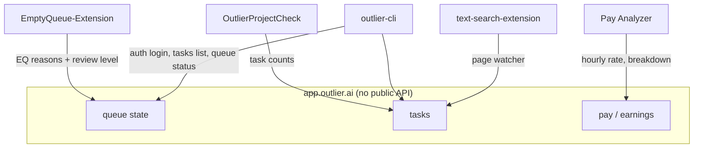

# outlier-toolkit — work Outlier AI missions more efficiently

<div align="right">


</div>

## Why should you care?

Outlier (Scale AI's contributor platform) publishes no public API — so every
tool here drives the worker portal through browser automation or in-browser
inspection. Five curated tools, vendored with pinned commits and licenses:
a Chrome extension that explains *why* your queue is empty, a userscript that
shows task counts on project pages, an earnings Pay Analyzer, a Python CLI with
passwordless magic-link login, and a page watcher for task availability.

**License:** each vendored tool keeps its own license — see [VENDOR.md](VENDOR.md) for the full provenance table (upstream URLs, commit SHAs, licenses).

## Features

- **EmptyQueue-Extension** — surfaces *why* your Outlier queue is empty (19 EQ reason tags) plus your review level per project; details previously only visible via devtools
- **OutlierProjectCheck** — Tampermonkey userscript showing the task count on any `app.outlier.ai/projects/<id>` page (and the EQ reason when available), via Outlier's internal API
- **Outlier-Tools Pay Analyzer** — local, in-browser earnings visualization: total pay, hourly rate, project breakdown, pay-cycle search; all processing client-side (archived upstream, kept for the Pay Analyzer)
- **outlier-cli** — Python CLI for the worker portal: `outlier tasks list`, `outlier queue status`, passwordless magic-link login (reads the emailed link via Gmail), persistent browser profile
- **text-search-extension** — generic Chromium auto-refresh + text-match page watcher; usable as a task-availability notifier

## How it fits together



## Quick start

```bash
outlier auth login      # passwordless: mails a fresh link, consumes it from Gmail
outlier queue status    # machine-readable queue state
outlier tasks list      # what's available right now
```

(From [OUTLIER-CLI-READINESS.md](OUTLIER-CLI-READINESS.md): install via
`uv tool install` from `vendor/outlier-cli`; set `ACCOUNT_EMAIL` in
`~/.local/share/cli-tools/outlier/.env` first.)

## Vendored tools

| Tool | What it does | License |
|---|---|---|
| `vendor/EmptyQueue-Extension` | EQ reason tags + review level per project | MIT |
| `vendor/OutlierProjectCheck` | Task counts on project pages | none declared |
| `vendor/Outlier-Tools` | Pay Analyzer earnings visualization | MIT |
| `vendor/outlier-cli` | Portal CLI, magic-link auth | MIT |
| `vendor/text-search-extension` | Auto-refresh + text-match page watcher | none declared |

Full provenance — upstream URLs, pinned commit SHAs, star counts at vendoring
time — in [VENDOR.md](VENDOR.md). All cloned `--depth 1` on 2026-09-19. Do not
modify in place; re-vendor from upstream.

## Ideas for the missions angle

1. Port the OutlierProjectCheck task-count check into the `outlier-cli` flow (or a small headless poller) to page the moment queued tasks appear for Live S2S / other projects.
2. EmptyQueue-Extension's EQ reason descriptions + `outlier-cli`'s `queue status` give a machine-readable picture of queue state — feed into mission-availability alerting.
3. Outlier-Tools Pay Analyzer logic could be re-driven against current earnings pages for hourly-rate tracking across projects (upstream is archived, so fork it).

## Dev & contributing

- `watch.py` — repo-level watcher helper
- `hatch_outlier/` — hatch-side integration
- Vendoring policy: pin to a commit SHA, record it in `VENDOR.md`, never edit vendored trees in place

## License & security

No single repo license — each vendored tool ships under its own license
(MIT where declared; see [VENDOR.md](VENDOR.md)). Note: `Intizar-T/outlier`
was evaluated and **excluded** — it is a QA test script with hardcoded
credentials, not tooling. Keep credentials out of this repo.
